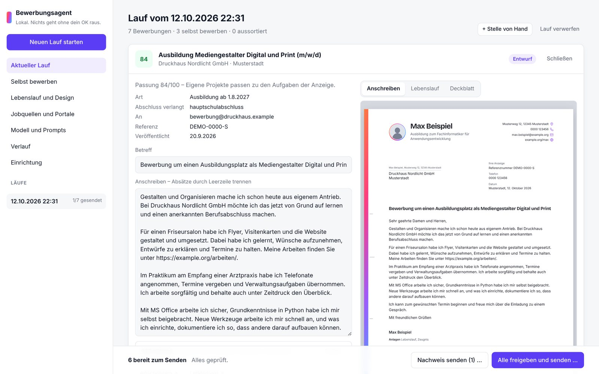
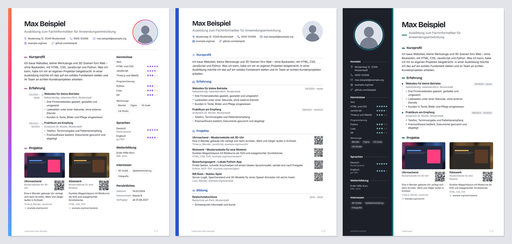
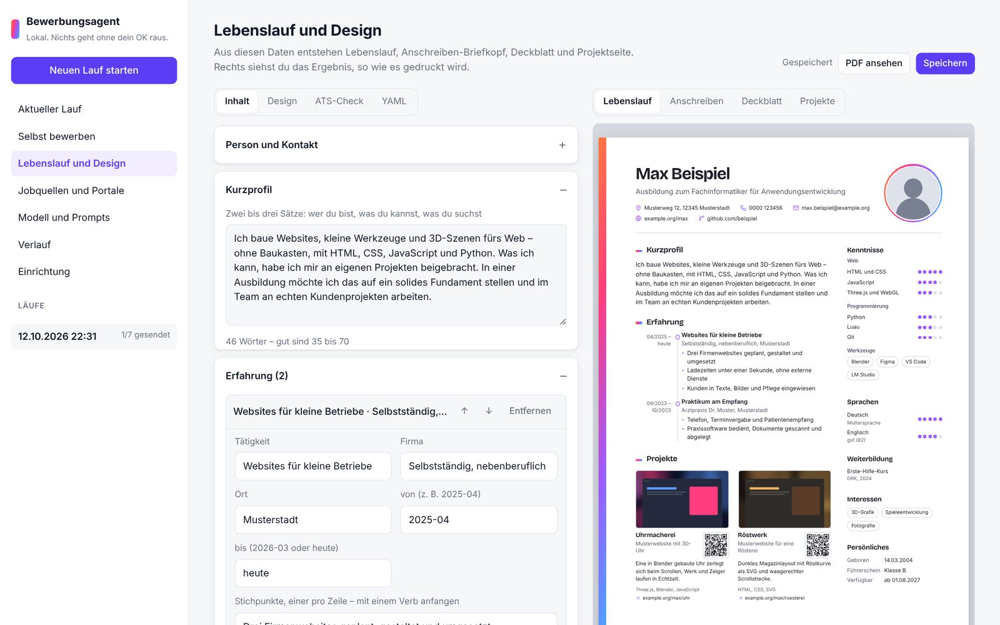
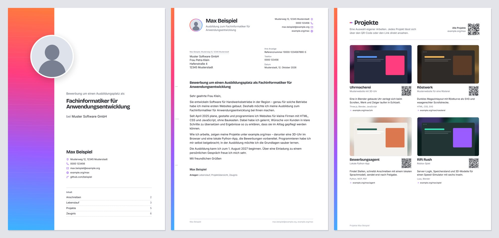
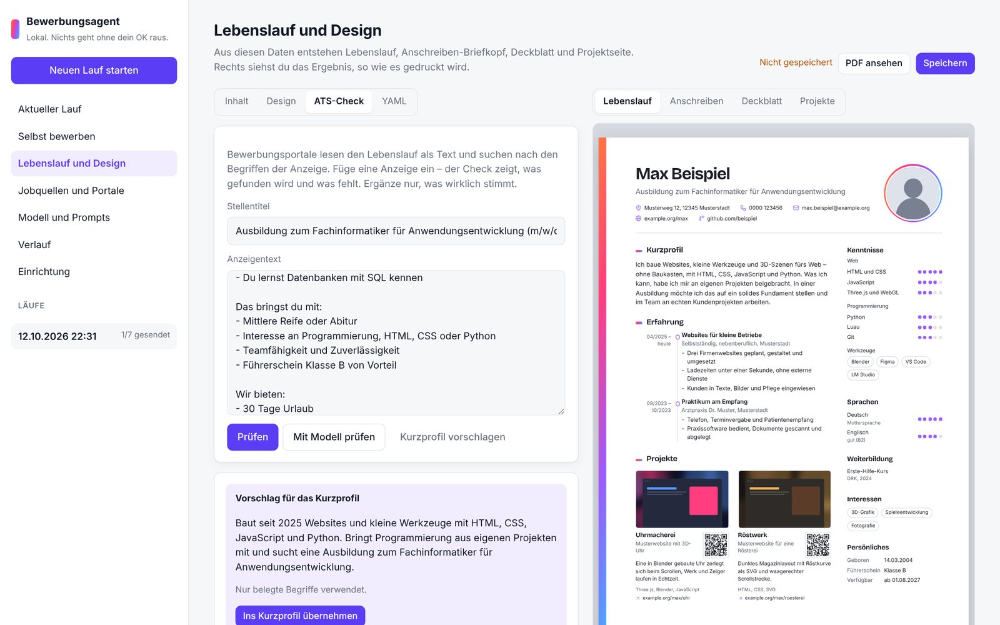
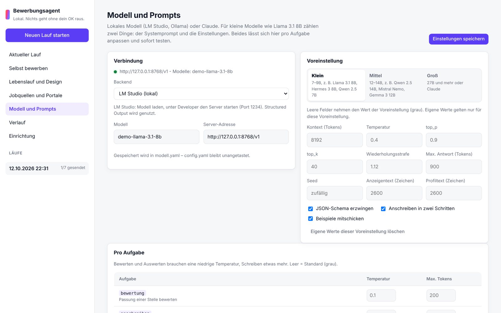
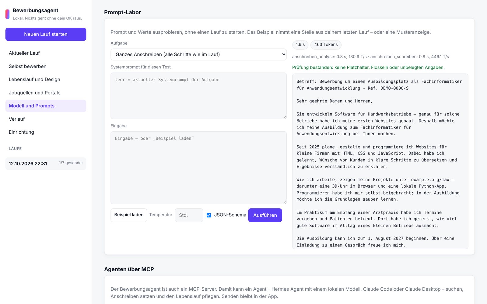
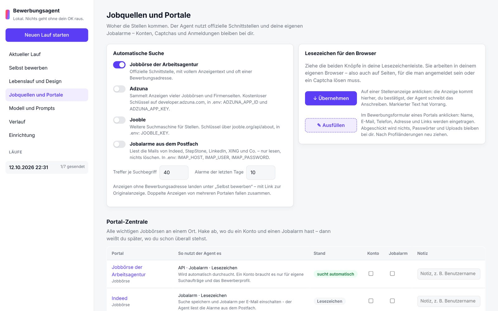

# bewerbungsagent

Findet passende Stellen, schreibt Anschreiben, setzt Lebenslauf, Deckblatt und Projektseite als gestaltete PDFs und verschickt alles **erst, wenn ein Mensch wörtlich `SENDEN` tippt** – an die Firmen und mit einem Bewerbungsnachweis an die zuständige Stelle.

Läuft komplett lokal. Keine Cloud, kein Konto, kein Abo. Die Texte schreibt wahlweise ein lokales Modell (LM Studio, Ollama, llama.cpp), Claude – über das eigene Abo oder die API – oder ein Agent wie Hermes oder Claude Code über den eingebauten MCP-Server.

```
Suchen ─────► Filtern ──► Bewerten ──► Anschreiben ──► Unterlagen ──► Prüfen in der App ──► SENDEN ──► Nachweis
Arbeitsagentur Regeln      Heuristik    lokales Modell   Lebenslauf     Editor, Vorschau,     SMTP       PDF-Tabelle
Adzuna, Jooble Sperrfrist  + Modell     zweistufig,      Anschreiben    ATS-Check                        + Anschreiben
Jobalarme      Dubletten                Faktencheck      Deckblatt
Link, Lesezeichen                       oder Claude      Mappe (PDF)
                                └──────────── Obsidian-Notiz je Stelle, Git-Commit ────────────┘
```





*Alle Bilder zeigen eine Vorführung mit erfundenen Daten – `python scripts/demo.py --app` legt sie an und startet die Oberfläche auf Port 8767.*

## Was es kann

| | |
|---|---|
| **Unterlagen** | Lebenslauf in drei Vorlagen, Anschreiben nach DIN 5008, Deckblatt mit Inhaltsverzeichnis, Projektseite mit QR-Codes – alles aus einer Datei, gesetzt als HTML und gedruckt mit dem Edge oder Chrome, der ohnehin auf dem Rechner liegt |
| **Editor** | Lebenslauf in der App bearbeiten, mit Live-Vorschau: Stationen, Projekte mit Bildern, Kenntnisse mit Skalen, Foto, Farbe, Schrift, Reihenfolge der Abschnitte |
| **Portfolio** | Projekte direkt aus der eigenen Website holen (`daten/projekte.js` oder JSON), samt Vorschaubildern und Links für die QR-Codes |
| **ATS-Check** | Gleicht die Begriffe einer Anzeige mit dem Lebenslauf ab, zeigt Treffer, Lücken und Hinweise. Auf Wunsch ein Kurzprofil je Stelle – nur aus belegten Fakten, Unbelegtes wird markiert |
| **Lokales Modell** | Voreinstellungen für 7–9B-, 12–14B- und große Modelle, JSON-Schema als Grammatik, Anschreiben in zwei Schritten, Faktencheck gegen Profil und Lebenslauf, Systemprompts pro Aufgabe editierbar, Prompt-Labor mit Tokens pro Sekunde |
| **Claude** | Über die Claude-Code-CLI (eigenes Abo), die Anthropic-API oder als Agent über MCP |
| **Jobquellen** | Jobbörse der Arbeitsagentur, Adzuna und Jooble über ihre offiziellen Schnittstellen, Jobalarme von Indeed, StepStone, LinkedIn, XING aus dem eigenen Postfach, Anzeigen per Link (schema.org/JobPosting) |
| **Lesezeichen** | „Übernehmen“ holt eine Anzeige aus dem eigenen Browser in die App – auch hinter Anmeldung oder Captcha. „Ausfüllen“ trägt Kontaktdaten in Bewerbungsformulare ein, ohne etwas abzuschicken |
| **Portal-Zentrale** | Die wichtigsten Jobbörsen an einem Ort, mit eigenem Stand: wo es ein Konto und einen Jobalarm gibt |
| **Kontakt** | Bewerbungsadresse und Ansprechpartner aus dem Anzeigentext, auch verschleiert (`jobs (at) firma [dot] de`); erkennt, wenn eine Adresse nur für Rückfragen dasteht oder ein Portal verlangt wird |
| **Versand** | Nur nach getipptem `SENDEN`. Einzelne PDFs oder eine Bewerbungsmappe, `.eml`-Kopie jeder Mail, Historie gegen Doppelbewerbungen, Nachweis an die Sachbearbeitung |
| **Agenten** | MCP-Server mit 17 Werkzeugen – **ohne** Sende-Werkzeug. Hermes-Skill und Konfiguration erzeugt die App mit den Pfaden des eigenen Rechners |
| **Wissensspeicher** | Eine Obsidian-Notiz je Stelle plus Übersicht, eigene Notizen bleiben beim Neuschreiben erhalten |

## Lebenslauf und Design

Alle Unterlagen entstehen aus `profil/lebenslauf.yaml`. Die App bearbeitet diese Datei im Reiter **Lebenslauf und Design**; rechts steht die Seite so, wie sie gedruckt wird. Anschreiben, Deckblatt und Projektseite übernehmen Kopf, Farbe und Schrift – die Mappe wirkt wie aus einem Guss.



- **Vorlagen:** *Profil* (zwei Spalten, Zeitleiste, Foto mit Farbring), *Klar* (eine Spalte, für Online-Portale, die den Text maschinell lesen), *Kontrast* (dunkle Seitenleiste).
- **Seiten:** Feste A4-Blätter. Ein kleines Skript verteilt die Abschnitte auf Seiten, hält Überschriften bei ihrem Inhalt, wiederholt Kopf und Seitenzahl und meldet, wenn etwas nicht passt. Das Anschreiben verkleinert die Schrift in Stufen, bevor es meldet, dass gekürzt werden muss.
- **Schriften und Symbole:** Bricolage Grotesque, Inter und Source Serif 4 (OFL) sind eingebettet, Symbole von Lucide (ISC). Es muss nichts installiert werden.
- **Druck:** Über Edge, Chrome oder Chromium im Hintergrund (`--headless --print-to-pdf`). Fehlt der Browser, fällt das Anschreiben auf ein schlichtes fpdf2-Layout zurück.
- **Beim Versand:** einzelne PDFs (Anschreiben, Lebenslauf, optional Projektseite, Anlagen) oder eine Mappe mit Deckblatt und Inhaltsverzeichnis. Mit einem Kurzprofil je Stelle entsteht ein eigener Lebenslauf für genau diese Bewerbung.



### ATS-Check

Bewerbungsportale lesen den Lebenslauf als Text und suchen nach den Begriffen der Anzeige. Der Check zieht diese Begriffe heraus – Stellentitel, Fachbegriffe, Werkzeuge, Abschlüsse – und gewichtet die Anforderungen höher als die Aufgaben; was die Firma selbst bietet („30 Tage Urlaub“), zählt nicht. Synonyme, Wortstämme und Alternativen („Mittlere Reife oder Abitur“) werden erkannt. Mit Modell kommen weitere Begriffe dazu, aber nur solche, die auch in der Anzeige stehen.



## Mit einem lokalen Modell arbeiten

Für Modelle um 8B – Llama 3.1 8B, Hermes 3 8B, Qwen 2.5 7B – entscheiden Systemprompt und Einstellungen. Beides steht im Reiter **Modell und Prompts** und in `modell.yaml` (Vorlage: `modell.example.yaml`).



- **Voreinstellungen** `klein`, `mittel`, `gross` mit Kontext, Temperatur, top_p, top_k, Wiederholungsstrafe, Antwortlänge, Seed. Jeder Wert lässt sich je Voreinstellung und je Aufgabe überschreiben.
- **JSON-Schema als Grammatik:** LM Studio bekommt `response_format: json_schema`, Ollama `format` über die eigene API – dort setzt der Agent auch `num_ctx`, damit lange Anzeigen nicht still abgeschnitten werden.
- **Zwei Schritte statt einem:** erst wertet das Modell die Anzeige aus und ordnet jeder Anforderung einen Beleg aus dem Profil zu, dann schreibt es. Belege, die nicht im Profil stehen, werden vor dem Schreiben verworfen.
- **Faktencheck:** Jahreszahlen, Zahlen mit Einheit und Nachweise wie „Zertifikat“ oder „Führerschein“, die weder in Profil, Lebenslauf noch Anzeige stehen, landen als Mangel in der Prüfung.
- **Prompts:** liegen als Markdown im Paket, mit eigener Kurzfassung für kleine Modelle. Eigene Fassungen schreibt die App nach `profil/prompts/`; „Standard wiederherstellen“ löscht sie wieder.
- **Prompt-Labor:** Prompt und Werte an einer echten Stelle aus dem letzten Lauf ausprobieren – mit Dauer, Tokens pro Sekunde und automatischer Prüfung.



| Backend | Wofür |
|---|---|
| `lmstudio` | LM Studio, Server auf Port 1234 |
| `ollama` | Ollama, native API mit `num_ctx` |
| `openai` | jeder Server mit `/v1/chat/completions` (llama.cpp, vLLM, Jan) |
| `claude-cli` | Claude über die Claude-Code-CLI und das eigene Abo |
| `anthropic` | Claude über die Anthropic-API, Schlüssel in `.env` |
| `keins` | kein Modell – Texte kommen von einem Agenten über MCP |

## Jobquellen



- **Arbeitsagentur** – öffentliche Jobsuche-API (`pc/v6/jobs`, `pc/v4/jobdetails`), voller Anzeigentext, oft mit Bewerbungsadresse.
- **Adzuna** und **Jooble** – offizielle Such-APIs mit kostenlosem Schlüssel (`ADZUNA_APP_ID`, `ADZUNA_APP_KEY`, `JOOBLE_KEY` in `.env`). Sie sammeln Anzeigen vieler Jobbörsen und Firmenseiten.
- **Jobalarme** – Indeed, StepStone, LinkedIn, XING, Monster und Glassdoor verschicken auf Wunsch täglich passende Anzeigen. Der Agent liest diese Mails per IMAP (nur lesen, nichts löschen) und holt Titel, Firma, Ort und Link heraus.
- **Per Link** – Karriereseiten beschreiben ihre Anzeigen fast immer als schema.org/JobPosting. Link einfügen genügt.
- **Lesezeichen „Übernehmen“** – für Seiten, die automatische Abrufe sperren: Anzeige im eigenen Browser öffnen, Lesezeichen anklicken, in der App bestätigen. Die Anzeige reist im Adress-Anker und verlässt nie den Rechner.

Doppelte Anzeigen von mehreren Portalen fallen zusammen. Stellen ohne Bewerbungsadresse landen unter „Selbst bewerben“ – mit Link zur Originalanzeige, fertigen PDFs und „als beworben markieren“.

## Schnellstart (Windows)

```bat
Bewerbungsagent starten.bat
```

Legt beim ersten Start `.venv` an, prüft die Einrichtung und öffnet `http://127.0.0.1:8765`. Edge liegt jedem Windows bei – für die gestalteten PDFs muss nichts weiter installiert werden.

Von Hand:

```bash
python -m venv .venv
.venv\Scripts\python -m pip install -e ".[mcp,dev]"
copy profil.example.md profil\profil.md       # Abschluss, Erfahrung, Ziele, Suchbegriffe
copy config.example.yaml config.yaml
copy .env.example .env                        # SMTP-Zugang, z. B. Gmail-App-Passwort
.venv\Scripts\python -m bewerbungsagent status
```

Danach in der App unter **Lebenslauf und Design** den Lebenslauf anlegen – „Aus Profil übernehmen“ füllt Kopf und Stationen vor, der Portfolio-Import die Projekte.

## Befehle

| Befehl | Zweck |
|---|---|
| `python -m bewerbungsagent app` | Oberfläche |
| `python -m bewerbungsagent suchen` | Trockenlauf: nur suchen und filtern, nichts speichern |
| `python -m bewerbungsagent lauf` | Neuer Lauf im Terminal |
| `python -m bewerbungsagent senden <lauf-id>` | Versand mit Rückfrage im Terminal |
| `python -m bewerbungsagent lebenslauf [ziel.pdf] [--projekte]` | Lebenslauf (und Projektseite) als PDF |
| `python -m bewerbungsagent portfolio <url oder ordner>` | Projekte aus der eigenen Website holen |
| `python -m bewerbungsagent ats <datei> [--modell]` | ATS-Check einer Anzeige, `-` liest von stdin |
| `python -m bewerbungsagent stelle <url>` | Anzeige per Link als Entwurf anlegen |
| `python -m bewerbungsagent hermes-skill` | Skill für Hermes Agent installieren |
| `python -m bewerbungsagent mcp` | MCP-Server über stdio |
| `python -m bewerbungsagent status` | Einrichtung prüfen |
| `python scripts/demo.py --app` | Vorführung mit erfundenen Daten auf Port 8767 |
| `python scripts/test_smtp.py` | lokaler Mail-Auffangserver für Probeläufe, stellt nichts zu |

## An einen Agenten anbinden

Der MCP-Server bietet `profil_zeigen`, `lebenslauf_zeigen`, `lebenslauf_aendern`, `lauf_starten`, `laeufe_auflisten`, `lauf_zeigen`, `anschreiben_regeln`, `anschreiben_setzen`, `ats_pruefen`, `kurzprofil_fuer_stelle`, `stelle_aus_link`, `stelle_hinzufuegen`, `stelle_uebernehmen`, `stelle_entfernen`, `portfolio_importieren`, `prompt_zeigen` und `versand_pruefen`. Ein Agent kann also suchen, lesen, schreiben und den Lebenslauf pflegen – aber nicht senden. Eine präparierte Stellenanzeige kann ihn deshalb auch nicht zum Verschicken bringen.

Die App zeigt unter **Modell und Prompts → Agenten über MCP** die fertigen Einträge mit den Pfaden des eigenen Rechners. Der Systemprompt für Agenten (`prompts/agent.md`) ist für kleine Modelle geschrieben: feste Reihenfolge, kurze Sätze, klare Verbote.

**Hermes Agent** – `~/.hermes/config.yaml`, danach `/reload-mcp`:

```yaml
mcp_servers:
  bewerbungsagent:
    command: "C:/Pfad/zu/bewerbungsagent/.venv/Scripts/python.exe"
    args: ["-m", "bewerbungsagent", "mcp"]
    env:
      BEWERBUNGSAGENT_WURZEL: "C:/Pfad/zu/bewerbungsagent"
```

`python -m bewerbungsagent hermes-skill` legt zusätzlich `~/.hermes/skills/bewerbungsagent/SKILL.md` an. Hermes braucht ein Modell mit mindestens 64k Kontext.

**Claude Code:**

```bash
claude mcp add bewerbungsagent -s user -e BEWERBUNGSAGENT_WURZEL="C:/Pfad/zu/bewerbungsagent" -- "C:/Pfad/zu/bewerbungsagent/.venv/Scripts/python.exe" -m bewerbungsagent mcp
```

**Claude Desktop** – `claude_desktop_config.json`:

```json
{
  "mcpServers": {
    "bewerbungsagent": {
      "command": "C:/Pfad/zu/bewerbungsagent/.venv/Scripts/python.exe",
      "args": ["-m", "bewerbungsagent", "mcp"],
      "env": { "BEWERBUNGSAGENT_WURZEL": "C:/Pfad/zu/bewerbungsagent" }
    }
  }
}
```

Ohne eigenes Modell `llm.backend: keins` setzen. Der Lauf legt dann nur die Stellen an, der Agent schreibt die Texte über `anschreiben_setzen`.

## Sicherheit

- Die App lauscht nur auf `127.0.0.1`. Jeder API-Aufruf braucht ein Token, das bei jedem Start neu erzeugt wird und nur in der ausgelieferten Seite steht. Der `Host`-Header muss lokal sein (gegen DNS-Rebinding).
- Vorschauen laufen unter eigener, strenger Content-Security-Policy; Texte aus Anzeigen und Lebenslauf werden beim Setzen maskiert.
- Senden verlangt das Wort `SENDEN`, in der App wie im Terminal. `senden` im Terminal verweigert, wenn stdin keine Konsole ist.
- Eine Anzeige vom Lesezeichen wird erst nach Bestätigung in der App übernommen und nur als Entwurf angelegt.
- `profil/`, `config.yaml`, `modell.yaml`, `.env` und `daten/` stehen in `.gitignore`.

## Was es bewusst nicht tut

- **Keine Captchas lösen und keinen Bot-Schutz umgehen.** Seiten, die automatische Abrufe sperren, öffnet man selbst – das Lesezeichen holt die Anzeige dann aus dem eigenen Browser.
- **Keine Konten anlegen, keine Passwörter speichern.** Die Portal-Zentrale führt zu den Portalen und merkt sich den eigenen Stand; anmelden muss man sich selbst.
- **Keine Formulare abschicken.** „Ausfüllen“ trägt nur Kontaktdaten ein, Passwort- und Upload-Felder bleiben leer.
- **Nichts erfinden.** Das Modell bekommt nur Profil und Lebenslauf als Faktenbasis, und die Prüfung markiert verdächtige Stellen im Text – lesen muss man trotzdem.

## Tests

```bash
.venv\Scripts\python -m pytest
```

97 Tests, ohne Netz und ohne Modell. Der Ende-zu-Ende-Test schickt echte SMTP-Mails an einen lokalen `aiosmtpd`-Server und prüft Empfänger, BCC und Anhänge. Die Drucktests laufen, wenn ein Chromium-Browser gefunden wird, und prüfen Seitenzahlen, Überlauf und die Mappe.

## Aufbau

```
bewerbungsagent/
  quellen/            arbeitsagentur, adzuna, jooble, jsonld (Link/Lesezeichen), mailalarm (IMAP)
  kontakt.py          E-Mail und Ansprechpartner aus Freitext
  bewertung.py        Regeln, Heuristik, Modellbewertung
  anschreiben.py      ein- und zweistufig, Prüfung, Faktencheck
  llm.py              LM Studio, Ollama, OpenAI-kompatibel, Claude-CLI, Anthropic-API; Messung
  modellcfg.py        Voreinstellungen, Werte je Aufgabe, Prompts
  prompts/            Systemprompts als Markdown, Kurzfassungen für kleine Modelle
  schemata.py         JSON-Schemas je Aufgabe
  lebenslauf.py       Datenmodell des Lebenslaufs
  render.py           Jinja2-Vorlagen -> HTML
  vorlagen/           Lebenslauf (3), Anschreiben, Deckblatt, Projektseite, Seitenumbruch, Symbole
  drucker.py          HTML -> PDF über Edge/Chrome/Chromium
  unterlagen.py       Anschreiben, Lebenslauf, Mappe, Anhänge
  ats.py              Begriffe, Abgleich, Kurzprofil-Vorschlag
  portfolio.py        Projekte aus der eigenen Website
  lesezeichen.py      Bookmarklets Übernehmen und Ausfüllen
  portale.py          Portal-Zentrale
  integrationen.py    Hermes, Claude Code, Claude Desktop
  pdf.py              einfaches Layout und Bewerbungsnachweis
  mail.py             Nachrichten und SMTP
  dienst.py           der Ablauf, von CLI, App und MCP genutzt
  vault.py            Obsidian-Notizen und Git-Commit
  app.py + statisch/  Web-Oberfläche, nur Standardbibliothek
  mcp_server.py       MCP-Werkzeuge
```

## Lizenz

MIT. Eingebettete Schriften: Inter, Bricolage Grotesque, Source Serif 4 unter der SIL Open Font License (`bewerbungsagent/statisch/schriften/`). Symbole: Lucide, ISC-Lizenz (`bewerbungsagent/vorlagen/LICENSE-lucide.txt`).
